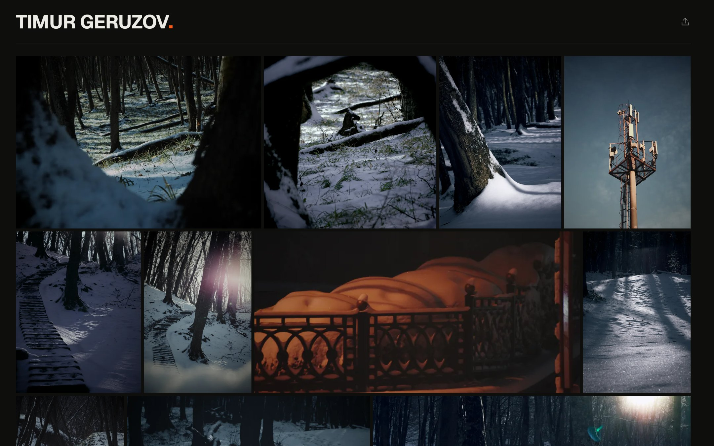
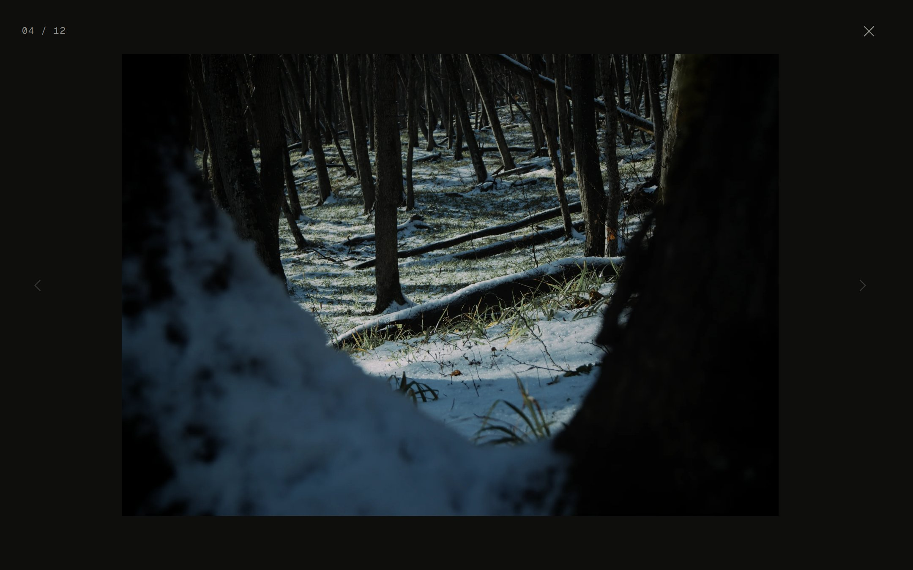
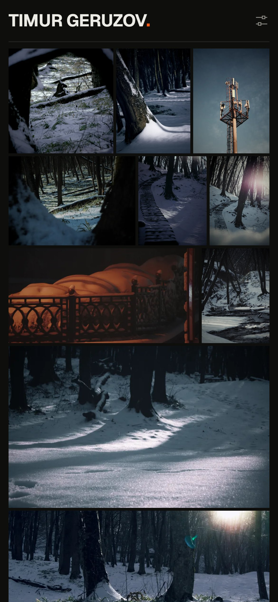
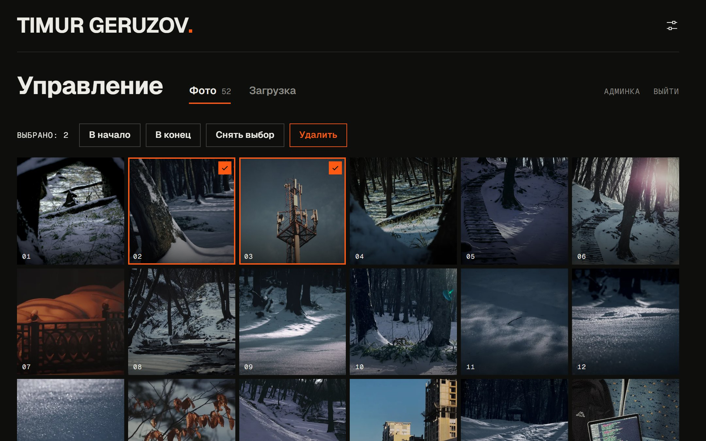
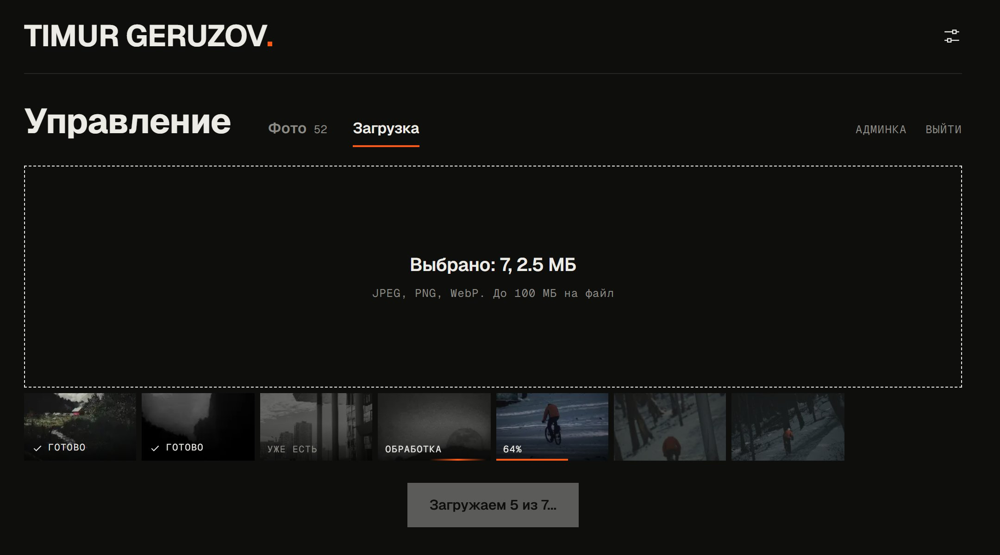

<div align="center">

# Django Photo Gallery

**Персональная фотогалерея на Django**


[](./LICENSE)

</div>

Я сделал эту галерею для своих фотографий: без ленты соцсетей, рекламы и чужого оформления. Снимки идут сплошной сеткой ровными строками, открываются на весь экран, а интерфейс вокруг них держится тихо и не спорит с фото. Всё, что нужно для работы, - Docker: одна команда поднимает базу и сайт.

<p align="center">
  
</p>

Сетка раскладывает фото строками одной высоты, слева направо: новые снимки встают первыми, а порядок можно поменять в разделе управления. Новые снимки подгружаются по 12 штук при прокрутке, и уже показанные фото при этом не сдвигаются: меняется только последняя строка. На телефоне в строке по два снимка.

---

## Запуск

Нужен установленный [Docker](https://www.docker.com/products/docker-desktop/) с Docker Compose.

```bash
git clone https://github.com/tgeruzov/django-photo-gallery.git
cd django-photo-gallery
docker compose up --build
```

Галерея откроется на [localhost:8000](http://localhost:8000). При первом запуске Docker соберёт образ, поднимет PostgreSQL, применит миграции и создаст локального администратора: логин `admin`, пароль `admin`. Пустая галерея предложит войти, после входа сразу откроется загрузка фото, а в шапке появится иконка управления.

Порт, логин и пароль администратора и пароль базы можно поменять без правки `docker-compose.yml`: скопируйте `.env.example` в `.env` и задайте там свои значения. Файл `.env` не попадает ни в git, ни в Docker-образ.

Код подключён в контейнер напрямую, поэтому правки подхватываются без пересборки. Миграции базы тоже применяются сами: после `git pull` сервер разработки (`python manage.py devserver`) доустанавливает новые миграции на первом же запросе, перезапускать контейнер не нужно. Загруженные фото лежат в папке `media/` рядом с кодом, база - в томе Docker `postgres_data`, они переживают перезапуск. Остановить: <kbd>Ctrl</kbd>+<kbd>C</kbd> или `docker compose down`.

> [!WARNING]
> `docker-compose.yml` рассчитан только на локальный запуск: там включён режим отладки и простой пароль администратора. Как запускать галерею на сервере - в разделе [Деплой](#деплой).

Docker Desktop в Windows работает через WSL 2 и при старте просит у системы несколько гигабайт памяти. Если он не запускается с ошибкой `ERROR_NO_SYSTEM_RESOURCES`, закройте тяжёлые программы или ограничьте память WSL в `%UserProfile%\.wslconfig`, например строками `[wsl2]` и `memory=4GB`.

---

## Как пользоваться

### Просмотр
Клик по фото открывает его на весь экран: снимок вырастает из своей карточки, а при закрытии возвращается в неё. Сначала показывается миниатюра, полная версия подменяет её, как только загрузится, а соседние снимки подгружаются заранее, поэтому листание идёт без задержек. Когда листание доходит до конца загруженных фото, галерея сама подгружает следующие.

Управление в просмотре едва заметно: счётчик в углу, крестик и стрелки вдоль краёв экрана, которые проступают при наведении. Через 2.5 секунды без движения мыши всё это гаснет вместе с курсором, и остаётся только фото.

| Действие | Мышь и клавиатура | Телефон |
|---|---|---|
| Следующее и предыдущее фото | клавиши со стрелками вправо и влево или стрелки у краёв экрана | свайп влево и вправо |
| Увеличить | двойной клик по фото | двойной тап или щипок |
| Подвинуть увеличенное фото | перетащить мышью | перетащить пальцем |
| Закрыть | <kbd>Esc</kbd>, крестик или клик по фону | свайп вниз |

<p align="center">
  
  &nbsp;&nbsp;
  
</p>

### Управление
Управлять галереей может только администратор: иконка с ползунками в шапке открывает раздел `/manage/`. В нём две вкладки, `Фото` и `Загрузка`, а справа ссылки на админку Django и выход.

### Порядок и удаление
Во вкладке `Фото` все снимки стоят квадратами в том же порядке, что и в галерее, с номером места внизу.
* Перетащите фото мышью, чтобы поменять порядок. На телефоне фото нужно сначала подержать, а обычный свайп просто прокручивает страницу.
* Клик или касание выбирает фото, клик с <kbd>Shift</kbd> выбирает диапазон. Выбранные можно отправить `В начало` или `В конец` либо удалить.
* Перед удалением галерея переспрашивает: фото удаляются вместе со всеми версиями на диске, безвозвратно.
* Порядок сохраняется сам через полсекунды после изменения, статус виден справа над сеткой.
* С клавиатуры: стрелки переводят фокус, <kbd>Alt</kbd> со стрелками двигает фото, пробел выбирает, <kbd>Delete</kbd> удаляет выбранные, <kbd>Esc</kbd> снимает выбор.

<p align="center">
  
</p>

### Загрузка
Во вкладке `Загрузка` файлы можно выбрать или перетащить в рамку, подходят JPEG, PNG и WebP до 100 МБ каждый. Лишний файл убирается крестиком на его превью.

После `Опубликовать` файлы уходят по одному, и на каждом превью видно, что с ним происходит:
* `64%` и оранжевая полоска - файл отправляется, полоска показывает настоящий прогресс отправки
* `Обработка` - файл уже на сервере, галерея готовит его версии
* `Готово` с галочкой - фото опубликовано
* `Уже есть` и чёрно-белое превью - такое фото уже есть в галерее, повторно оно не загружается
* `Ошибка` и оранжевая линия - файл не принят, причина видна в подсказке при наведении

Приглушённые превью ждут своей очереди. Если всё прошло успешно, галерея откроется сама, а если часть файлов не загрузилась, на странице останутся только они и кнопка `Повторить`. Если все выбранные фото уже были в галерее, страница скажет об этом и останется открытой.

<p align="center">
  
</p>

### Админка
В `/admin/` у каждого фото можно заполнить заголовок и альтернативный текст: они не показываются в галерее, но уходят в подписи для экранных читалок и в метаданные для поисковиков. Там же фото можно удалить. Фото можно добавить и в админке или заменить у него оригинал: файл проходит те же проверки, что и на странице загрузки, версии строятся заново, а новое фото встаёт первым. После пяти неудачных попыток входа подряд вход под этим логином закрывается на 15 минут.

---

## Как обрабатываются фото

Галерея хранит оригинал и сразу при загрузке делает из него три версии в WebP:

| Версия | Размер по длинной стороне | Где используется |
|---|---|---|
| Миниатюра | 800 px | сетка галереи |
| Средняя | 1600 px | просмотр на телефонах и небольших экранах |
| Оптимизированная | 2560 px | просмотр на больших экранах |

* Поворот из EXIF применяется, прозрачность PNG сохраняется, цветовой профиль (например, Display P3 с iPhone) переносится в версии, 16-битные PNG не пересвечиваются.
* Дубликаты отсекаются по хешу SHA-256 содержимого, а не по имени файла.
* Если файл не удаётся прочитать как изображение, загрузка откатывается целиком, и в галерее не остаётся фото без превью.
* Оригинал сохраняется под случайным именем: в нём остаётся EXIF, иногда с координатами съёмки, и адрес вида `IMG_1234.jpg` не угадать. В версиях EXIF нет.
* Оригиналы по умолчанию хранятся. Если нужно место, `DELETE_ORIGINAL_AFTER_OPTIMIZE=1` удаляет их после создания версий, безвозвратно.

---

## Деплой

Образ из `Dockerfile` готов к работе на сервере: при старте он применяет миграции и запускает Gunicorn, а статику раздаёт сам через WhiteNoise. Что нужно задать в окружении:
* `DEBUG=0` - без этого включён режим отладки
* `SECRET_KEY` - длинная случайная строка, например из `python -c "import secrets; print(secrets.token_urlsafe(50))"`. Без неё при `DEBUG=0` приложение не запустится
* `ALLOWED_HOSTS` и `CSRF_TRUSTED_ORIGINS` - ваш домен, например `photo.example.com` и `https://photo.example.com`
* `DB_HOST`, `DB_NAME`, `DB_USER`, `DB_PASSWORD` - доступ к PostgreSQL

Удобнее всего собрать их в файл `.env` на сервере (образец со всеми переменными - `.env.example`) и передать контейнеру целиком:

```bash
docker build -t django-photo-gallery .
docker run -d --name gallery --restart unless-stopped -p 127.0.0.1:8000:8000 --env-file .env -v /srv/gallery/media:/app/media django-photo-gallery
```

Ошибка в значении переменной, например `MAX_UPLOAD_SIZE_MB=1O0`, останавливает запуск с сообщением, где названа переменная. `docker stop` останавливает Gunicorn мягко: начатые запросы дорабатывают. Каждая строка лога содержит время, уровень и источник, Gunicorn пишет и журнал запросов.

Проверка живости - `/healthz`: отвечает `200 {"status": "ok"}`, когда приложение и база работают, и `503`, когда база недоступна. Адрес не перенаправляется на HTTPS и понимает и `GET`, и `HEAD`, так что подходит и для healthcheck контейнера, и для внешнего мониторинга.

Загруженные фото при `DEBUG=0` Django не раздаёт: папку `media/` должен отдавать веб-сервер перед приложением, например nginx по пути `/media/`. Он же обычно держит HTTPS; приложение ждёт заголовок `X-Forwarded-Proto` и само перенаправляет на HTTPS.

Что важно в конфигурации nginx:
* `client_max_body_size 100m;` или больше, под `MAX_UPLOAD_SIZE_MB`. По умолчанию nginx пропускает только 1 МБ, и более крупные снимки не загрузятся: на странице загрузки будет ошибка 413.
* Если оригиналы не должны быть доступны вовсе, закройте их: `location /media/photos/ { deny all; }`. Галерея показывает только версии в WebP, оригинал нужен ей лишь для фото, у которого версии не построились.

Минимальный `server` для nginx с уже настроенным HTTPS (сертификаты опущены):

```nginx
server {
    listen 443 ssl;
    server_name photo.example.com;
    client_max_body_size 100m;

    location /media/ {
        alias /srv/gallery/media/;
        expires 30d;
    }

    location / {
        proxy_pass http://127.0.0.1:8000;
        proxy_set_header Host $host;
        proxy_set_header X-Forwarded-Proto $scheme;
        proxy_set_header X-Forwarded-For $proxy_add_x_forwarded_for;
        proxy_read_timeout 120s;
    }
}
```

Приложение в образе работает от пользователя `app` (uid 1000), не от root. Папка, которая монтируется в `/app/media`, должна быть доступна ему на запись: для тома Docker это так и есть, для папки на хосте выполните `chown -R 1000:1000` на неё.

Остальные переменные:

| Переменная | По умолчанию | Что задаёт |
|---|---|---|
| `DB_PORT` | `5432` | порт PostgreSQL |
| `MEDIA_ROOT` | `/app/media` | папка для фото внутри контейнера |
| `MAX_UPLOAD_SIZE_MB` | `100` | лимит размера одного файла |
| `DELETE_ORIGINAL_AFTER_OPTIMIZE` | `0` | удалять оригиналы после создания версий |
| `SECURE_SSL_REDIRECT` | `1` | перенаправлять HTTP на HTTPS при `DEBUG=0` |
| `SECURE_HSTS_SECONDS` | `2592000` | срок HSTS при `DEBUG=0` |
| `LOG_LEVEL` | `INFO` | уровень логов в консоли |
| `WEB_CONCURRENCY` | `3` | число процессов Gunicorn. Обработка крупного снимка занимает сотни мегабайт памяти на процесс: 48-мегапиксельный JPEG около 150 МБ, PNG того же размера в несколько раз больше. На сервере с 1 ГБ памяти лучше `2` |

Храните резервные копии базы и папки `media/`: оригиналы фото есть только там.

---

## Если что-то пошло не так

* **Порт 8000 занят:** задайте другой в `.env`, например `WEB_PORT=8080`, и откройте [localhost:8080](http://localhost:8080).
* **После обновления страница выглядит по-старому:** браузер держит старые CSS и JS, обновите страницу с очисткой кэша (<kbd>Ctrl</kbd>+<kbd>F5</kbd>).
* **У фото нет превью:** например, если процесс оборвался посреди обработки. В `/admin/` отметьте такие фото и выберите действие `Generate missing derivatives`: галерея достроит недостающие версии.
* **Ошибка `column ... does not exist` после обновления:** база отстала от кода. Если контейнер запущен со старым `docker-compose.yml`, где ещё был `runserver`, перезапустите его один раз: `docker compose up -d web`. Дальше миграции будут применяться сами. Применить их вручную можно так: `docker compose exec web python manage.py migrate`.
* **Не видно иконки управления:** она показывается только администратору. Войдите через `/admin/`.

Страницы ошибок оформлены как плёнка: на 404 кадры вокруг пропавшего заполняются случайными снимками галереи, на 500 плёнка засвечена. На сервере они показываются при `DEBUG=0`, а в режиме разработки их можно открыть по адресам [localhost:8000/404/](http://localhost:8000/404/) и [localhost:8000/500/](http://localhost:8000/500/).

---

## Технические детали

Python 3.13, Django 6.1, PostgreSQL 16 через psycopg 3, Pillow, Gunicorn и WhiteNoise. Фронтенд на чистом JS и CSS без сборки: шрифты Geist и Geist Mono лежат в `static/fonts/` (лицензия OFL), без запросов к Google, одна тёмная тема. Переход при открытии фото и анимация имени в шапке написаны по мотивам компонентов [React Bits](https://reactbits.dev) без React.

| Путь | Назначение |
|---|---|
| `/` | галерея, отдаёт и JSON для подгрузки ленты |
| `/manage/photos/` | порядок и удаление фото, только для администратора |
| `/manage/upload/` | загрузка фото, только для администратора; старый адрес `/upload/` ведёт сюда |
| `/all_photos.json` | все фото постранично в JSON, до 200 на страницу |
| `/admin/` | админка Django |
| `/healthz` | проверка, что приложение и база отвечают |
| `/sitemap.xml`, `/robots.txt` | для поисковиков |

Весь код - в двух папках: `config/` (настройки и маршруты) и `gallery/` (модель, представления, обработка фото, SEO и шаблоны), статика - в `static/`. Настройки линтера и coverage лежат в `pyproject.toml`, инструменты разработки - в `requirements-dev.txt`, все переменные окружения с пояснениями - в `.env.example`.

---

## Разработка

Основные команды собраны в `Makefile`: `make help` покажет их список. Без `make`, например в Windows, те же команды запускаются напрямую:

| `make` | Команда | Что делает |
|---|---|---|
| `make dev` | `docker compose up --build` | галерея с базой на localhost:8000 |
| `make test` | `docker compose run --rm web python manage.py test` | все тесты в контейнере, база поднимается сама |
| `make check` | `docker compose run --rm web python manage.py check` | проверки Django; `makemigrations --check --dry-run` ищет забытые миграции |
| `make install` | `pip install -r requirements-dev.txt` | ruff, coverage и pip-audit в локальное окружение |
| `make lint` | `ruff check .`, `ruff format --check .`, `node --check static/js/script.js` и то же для `manage.js` | линтер, формат Python и синтаксис JS |
| `make audit` | `pip-audit -r requirements.txt` | известные уязвимости в зависимостях |
| `make build` | `docker build -t django-photo-gallery .` | образ для сервера |
| `make start` | `docker run --rm -p 8000:8000 --env-file .env django-photo-gallery` | образ для сервера с настройками из `.env` |

Тесты проверяют загрузку и обработку фото, админку, ленту, раздел управления, SEO, служебные адреса и разбор настроек, а один сквозной тест проходит весь путь владельца: вход, загрузку, порядок и удаление. Без Docker их можно запустить и на своём PostgreSQL 16: `DEBUG=1 DB_HOST=localhost python manage.py test`. Пользователь и пароль по умолчанию - `gallery`, пользователю нужно право создавать базы (`CREATEDB`): тесты работают в отдельной базе `test_gallery`. Покрытие: `coverage run manage.py test`, затем `coverage report`.

На GitHub на каждый push в `main` и на каждый pull request запускаются три задачи: линтер с аудитом зависимостей, тесты с проверкой продакшен-настроек через `check --deploy`, и сборка Docker-образа, который запускается с `DEBUG=0`, отвечает на `/healthz` и корректно останавливается.

Что изменилось в каждой версии - в [CHANGELOG.md](./CHANGELOG.md).

---

## Известные ограничения

* Ограничение попыток входа в админку хранится в памяти каждого процесса Gunicorn, поэтому замедляет подбор пароля, а не запрещает его полностью. Для публичного сервера стоит дополнительно ограничить `/admin/` на уровне nginx, например по IP.
* Фото обрабатываются прямо в запросе загрузки, без очереди задач: очень крупный PNG может обрабатываться десятки секунд и занимать заметную память. Таймаут Gunicorn - 120 секунд.
* Загруженные файлы раздаёт веб-сервер перед приложением, без него при `DEBUG=0` фото не откроются.
* Content Security Policy не настроена. Шаблоны экранируют всё, что вводит администратор, но заголовок CSP был бы дополнительной защитой.
* Галерея одна на сайт и рассчитана на одного владельца: прав на отдельные фото нет, управлять может любой пользователь с флагом `is_staff`.

## Лицензия

[GPL-3.0-only](./LICENSE)
